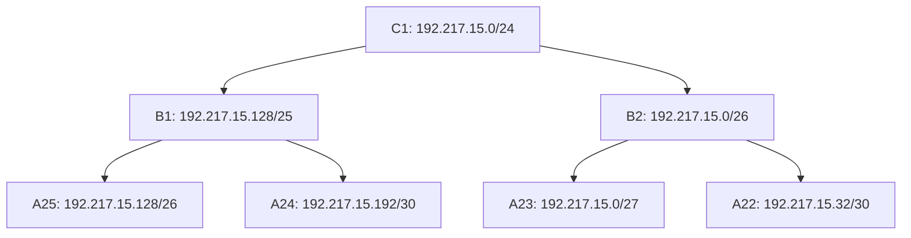

# K12 - Contekan Demo CIDR

Buka CPT dan spreadsheet. Ikuti urutan di bawah; kotak kutipan berisi kalimat yang bisa dibaca saat demo.

Gunakan [K12_Modul4_CIDR_Rapi.pkt](K12_Modul4_CIDR_Rapi.pkt) versi yang sudah dilengkapi WAN/NAT, dengan **Packet Tracer 9.0.1 atau versi kompatibel**. Pilih **Realtime** dan tunggu link aktif. Urutan demonya: **topologi → hitungan → pohon CIDR → routing → ping internal → jaringan luar**.

Untuk router, buka **CLI**. Untuk client, buka **Desktop → Command Prompt**. Jalankan `enable` ketika prompt router masih `NamaRouter>`. Setelah menjadi `NamaRouter#`, ketik command tanpa menyalin nama router atau tanda `#`.

## 1. Pembuka

Tunjukkan topologi, lalu ucapkan:

> “Kami menggunakan CIDR dengan prefix 192.217.x.x. Ada 25 subnet internal. Kebutuhan IP dihitung dari jumlah host ditambah interface router.”

Cyberia menjadi pintu keluar. Wired menjadi pusat percabangan.

| Bagian yang ditunjukkan | Penjelasan saat demo |
| --- | --- |
| Cyberia | Penghubung jaringan internal ke Cloud dan tempat konfigurasi NAT. |
| Wired | Meneruskan trafik ke cabang Psyche, Copland, Schumann, Navi, dan Tachibana. |
| Router cabang dan client | Router menjadi gateway segmen; setiap ikon client mewakili jumlah host pada label. |

Jumlah IP dihitung untuk seluruh kebutuhan host pada soal, meskipun CPT hanya menampilkan perangkat perwakilan. Interface router dalam setiap subnet ikut dihitung. Switch Layer 2 pada proyek ini tidak diberi IP manajemen, sehingga tidak ditambahkan ke kebutuhan alamat.

## 2. Jelaskan satu contoh hitungan: A25

Buka tabel A25 pada spreadsheet.

> “Lain membutuhkan 57 host dan Mika 4 host. Ditambah satu interface router, totalnya 62. Kami memakai /26 karena menyediakan 62 alamat usable.”

```text
57 + 4 + 1 = 62
2^6 - 2 = 62
32 - 6 = /26
```

| Yang ditunjukkan | Nilai |
| --- | --- |
| Network A25 | 192.217.15.128/26 |
| Netmask | 255.255.255.192 |
| Gateway | 192.217.15.129 |
| IP Lain | 192.217.15.130 |
| IP Mika | 192.217.15.131 |
| Broadcast | 192.217.15.191 |

Kalau ditanya “kenapa bukan /27?”: **/27 hanya menyediakan 30 alamat usable, sehingga tidak cukup.**

Supaya urutan hitungannya jelas, jelaskan:

1. Tentukan kebutuhan: **host + interface router**.
2. Cari bit host terkecil yang memenuhi `2^h − 2 ≥ kebutuhan`. Dua alamat digunakan untuk network dan broadcast.
3. Hitung prefix: `32 − h`. Pada A25, `h = 6`, sehingga prefix `/26`.
4. Ubah prefix ke mask: `/26 = 255.255.255.192`.
5. Hitung ukuran blok: `256 − 192 = 64` alamat. Network .128 berakhir pada `.128 + 64 − 1 = .191`.
6. Rentang usable A25 adalah **192.217.15.129–192.217.15.190**. Gateway memakai .129, Lain .130, dan Mika .131.

Pemilihan prefix menentukan kapasitas subnet. Pemilihan network ID .128 mengikuti posisi A25 dalam pohon alokasi CIDR.

| Contoh lain | Kebutuhan | Prefix dan alasannya |
| --- | --- | --- |
| A4: Karl dan Lin | 700 + 180 + 1 = 881 | /22 menyediakan 1.022 usable; /23 hanya 510. |
| A9: Omnipresence dan Denpa | 510 + 3 + 1 = 514 | Memerlukan /22 karena /23 hanya 510 usable. |
| A3: Wired, Psyche, Copland, Schumann | 0 + 4 = 4 | Memerlukan /29; /30 hanya dua usable. |
| A23: Semi | 14 + 1 = 15 | Memerlukan /27; /28 hanya 14 usable. |

<details>
<summary><strong>Tabel perhitungan seluruh subnet A1–A25</strong></summary>

| Subnet / segmen | Host + interface router | IP dibutuhkan | Kapasitas usable | Network ID / prefix |
| --- | --- | --- | --- | --- |
| A1 — Cyberia–Switch1–JJ, MyuMyu | 125 + 1 | 126 | 2^7 − 2 = 126 | 192.217.36.0/25 |
| A2 — Cyberia–Wired | 0 + 2 | 2 | 2^2 − 2 = 2 | 192.217.36.128/30 |
| A3 — Wired–Switch2–Psyche, Copland, Schumann | 0 + 4 | 4 | 2^3 − 2 = 6 | 192.217.28.16/29 |
| A4 — Psyche–Switch3–Karl, Lin | 880 + 1 | 881 | 2^10 − 2 = 1022 | 192.217.16.0/22 |
| A5 — Copland–Juri | 31 + 1 | 32 | 2^6 − 2 = 62 | 192.217.22.0/26 |
| A6 — Copland–Switch4–Masayuki | 300 + 1 | 301 | 2^9 − 2 = 510 | 192.217.20.0/23 |
| A7 — Schumann–Akashic | 3 + 1 | 4 | 2^3 − 2 = 6 | 192.217.28.0/29 |
| A8 — Schumann–Accela | 0 + 2 | 2 | 2^2 − 2 = 2 | 192.217.28.8/30 |
| A9 — Accela–Switch5–Omnipresence, Denpa | 513 + 1 | 514 | 2^10 − 2 = 1022 | 192.217.24.0/22 |
| A10 — Wired–Navi | 0 + 2 | 2 | 2^2 − 2 = 2 | 192.217.34.64/30 |
| A11 — Navi–Switch6–Alice, Reika | 253 + 1 | 254 | 2^8 − 2 = 254 | 192.217.32.0/24 |
| A12 — Navi–Switch7–Taro | 57 + 1 | 58 | 2^6 − 2 = 62 | 192.217.34.0/26 |
| A13 — Navi–Switch8–Yasuo, Miho, Kuma | 142 + 1 | 143 | 2^8 − 2 = 254 | 192.217.33.0/24 |
| A14 — Wired–Tachibana | 0 + 2 | 2 | 2^2 − 2 = 2 | 192.217.2.0/30 |
| A15 — Tachibana–Switch9–Collective, Ghost | 266 + 1 | 267 | 2^9 − 2 = 510 | 192.217.0.0/23 |
| A16 — Tachibana–Deus | 0 + 2 | 2 | 2^2 − 2 = 2 | 192.217.8.128/30 |
| A17 — Deus–Switch10–Lilith, Specter | 98 + 1 | 99 | 2^7 − 2 = 126 | 192.217.8.0/25 |
| A18 — Deus–Protocol7 | 0 + 2 | 2 | 2^2 − 2 = 2 | 192.217.12.64/30 |
| A19 — Protocol7–Switch11–Chisa, Hodgeson | 32 + 1 | 33 | 2^6 − 2 = 62 | 192.217.12.0/26 |
| A20 — Protocol7–Knights | 0 + 2 | 2 | 2^2 − 2 = 2 | 192.217.14.8/30 |
| A21 — Knights–Eiri | 2 + 1 | 3 | 2^3 − 2 = 6 | 192.217.14.0/29 |
| A22 — Knights–Phantoma | 0 + 2 | 2 | 2^2 − 2 = 2 | 192.217.15.32/30 |
| A23 — Phantoma–Switch12–Semi | 14 + 1 | 15 | 2^5 − 2 = 30 | 192.217.15.0/27 |
| A24 — Phantoma–Shibuya | 0 + 2 | 2 | 2^2 − 2 = 2 | 192.217.15.192/30 |
| A25 — Shibuya–Switch13–Lain, Mika | 61 + 1 | 62 | 2^6 − 2 = 62 | 192.217.15.128/26 |

Total kebutuhan internal: **2.777 host + 37 interface router = 2.814 IP**. Subnet transit tanpa client tetap membutuhkan alamat bagi interface router yang terhubung.

</details>

## 3. Jelaskan pohon CIDR

Buka pohon pada laporan atau sheet Penggabungan - CIDR.

> “Kami menggabungkan subnet dari cabang terluar menuju pusat. Contohnya A25 dan A24 menjadi B1. Penggabungan dilanjutkan sampai blok induk I1, yaitu 192.217.0.0/18.”



Pada pohon alokasi ini, anak ditempatkan pada bagian berbeda di dalam blok induk dan mengikuti batas network. Prefix induk satu tingkat lebih pendek dari prefix anak yang terpendek. Seluruh tahap B-I dapat ditunjukkan pada spreadsheet.

Urutan yang dijelaskan dari contoh pohon:

1. **A25 /26 + A24 /30 → B1 /25**. A25 menempati .128–.191, sedangkan A24 memakai .192–.195 di dalam B1 .128–.255.
2. **A23 /27 + A22 /30 → B2 /26**. Keduanya ditempatkan dalam blok .0–.63.
3. **B1 /25 + B2 /26 → C1 /24**. C1 mencakup 192.217.15.0–192.217.15.255.
4. Lanjutkan penggabungan cabang lain sampai **I1 = 192.217.0.0/18**.

> “CIDR membentuk kelompok subnet bertingkat. Setiap anak harus masuk ke blok induknya dan tidak bertumpuk dengan anak lain. Blok induk juga dapat memuat ruang cadangan.”

Aturan memperpendek prefix di atas menjelaskan metode pohon alokasi biner yang dipakai. Secara umum, ringkasan CIDR tetap ditentukan oleh bit prefix bersama dan batas network, sehingga alamatnya harus diperiksa sebelum digabungkan.

**Ingat:** /18 adalah blok agregat keseluruhan. Mask pada Mika tetap /26.

<details>
<summary><strong>Urutan penggabungan lengkap B1–I1</strong></summary>

| Tahap | Anak pertama | Anak kedua | Network ID / prefix induk |
| --- | --- | --- | --- |
| B1 | A25 /26 | A24 /30 | 192.217.15.128/25 |
| B2 | A23 /27 | A22 /30 | 192.217.15.0/26 |
| B3 | A21 /29 | A20 /30 | 192.217.14.0/28 |
| B4 | A19 /26 | A18 /30 | 192.217.12.0/25 |
| B5 | A17 /25 | A16 /30 | 192.217.8.0/24 |
| B6 | A15 /23 | A14 /30 | 192.217.0.0/22 |
| B7 | A7 /29 | A8 /30 | 192.217.28.0/28 |
| B8 | A5 /26 | A6 /23 | 192.217.20.0/22 |
| B9 | A10 /30 | A12 /26 | 192.217.34.0/25 |
| B10 | A11 /24 | A13 /24 | 192.217.32.0/23 |
| B11 | A1 /25 | A2 /30 | 192.217.36.0/24 |
| C1 | B1 /25 | B2 /26 | 192.217.15.0/24 |
| C2 | B7 /28 | A3 /29 | 192.217.28.0/27 |
| C3 | B8 /22 | A4 /22 | 192.217.16.0/21 |
| C4 | B9 /25 | B10 /23 | 192.217.32.0/22 |
| D1 | B3 /28 | C1 /24 | 192.217.14.0/23 |
| D2 | C2 /27 | A9 /22 | 192.217.24.0/21 |
| D3 | C4 /22 | B11 /24 | 192.217.32.0/21 |
| E1 | B4 /25 | D1 /23 | 192.217.12.0/22 |
| E2 | C3 /21 | D2 /21 | 192.217.16.0/20 |
| F1 | B5 /24 | E1 /22 | 192.217.8.0/21 |
| G1 | B6 /22 | F1 /21 | 192.217.0.0/20 |
| H1 | G1 /20 | E2 /20 | 192.217.0.0/19 |
| I1 | H1 /19 | D3 /21 | 192.217.0.0/18 |

I1 mencakup 192.217.0.0–192.217.63.255. Alamat interface dan client tetap menggunakan subnet daun A1–A25, bukan mask /18 untuk semuanya.

</details>

## 4. Jelaskan routing

Buka **Wired → CLI**. Jalankan per baris:

```text
enable
show ip interface brief
show ip route
show ip route 192.217.15.131
```

| Command | Yang dijelaskan |
| --- | --- |
| `show ip interface brief` | IP serta Status dan Protocol pada interface yang dipakai. |
| `show ip route` | Jaringan terhubung, static route, default route, dan next hop. |
| `show ip route 192.217.15.131` | Rute yang dipilih untuk menuju Mika. |

Periksa interface yang terpakai. Interface tanpa sambungan yang sengaja dimatikan dapat tetap `administratively down`. Jika keluaran berhenti pada `--More--`, tekan **Space** untuk halaman berikutnya atau **q** untuk keluar dari tampilan.

Lalu ucapkan:

> “IP Mika berada dalam 192.217.0.0/20. Wired mengirimkannya ke 192.217.2.2, yaitu Tachibana. Router berikutnya meneruskan paket sesuai routing masing-masing.”

Baris konfigurasi yang menjelaskan contoh tersebut:

```text
ip route 192.217.0.0 255.255.240.0 192.217.2.2
```

Arti baris tersebut: `192.217.0.0` adalah network tujuan, `255.255.240.0` adalah mask `/20`, dan `192.217.2.2` adalah **next hop Tachibana**. IP Mika termasuk dalam rentang agregat 192.217.0.0–192.217.15.255.

| Router yang dilewati | Rute yang mencakup Mika | Diteruskan ke |
| --- | --- | --- |
| Wired | 192.217.0.0/20 | Tachibana — 192.217.2.2. |
| Tachibana | 192.217.8.0/21 | Deus — 192.217.8.130. |
| Deus | 192.217.12.0/22 | Protocol7 — 192.217.12.66. |
| Protocol7 | 192.217.14.0/23 | Knights — 192.217.14.10. |
| Knights | 192.217.15.0/24 | Phantoma — 192.217.15.34. |
| Phantoma | 192.217.15.128/25 | Shibuya — 192.217.15.194. |
| Shibuya | 192.217.15.128/26 | LAN A25 melalui Fa0/1, menuju Mika 192.217.15.131. |

Tabel ini menjelaskan isi rancangan routing untuk satu tujuan. Saat demo, cukup jelaskan baris Wired, lalu tunjukkan bahwa penerusan berlanjut sampai Shibuya.

Jika ditanya rute balik:

> “Router cabang menggunakan default route ke induknya. Contohnya, default route Shibuya menuju Phantoma.”

Contoh default route pada **Shibuya**:

```text
ip route 0.0.0.0 0.0.0.0 192.217.15.193
```

Tujuan yang tidak memiliki rute lebih spesifik diarahkan ke Phantoma. Paket balasan juga memerlukan rute menuju sumber, sehingga gateway client dan rute balik sama-sama diperiksa.

Jika ditanya kode routing: **C = connected, L = IP router sendiri, S = static, S* = default static.**

Jika ditanya Null0:

> “Null0 membuang paket ke ruang agregat yang tidak memiliki rute lebih spesifik agar tidak terjadi loop.”

Contoh pada Wired adalah `ip route 192.217.0.0 255.255.192.0 Null0 254`. Router mendahulukan **prefix paling spesifik**. Angka 254 merupakan administrative distance, yang dibandingkan untuk kandidat rute dengan prefix yang sama.

## 5. Jalankan tiga jenis ping internal

### A. Router ke router

Pada **Wired → CLI**:

```text
ping 192.217.2.2
ping 192.217.15.194
```

> “Ping pertama dari Wired ke router tetangga Tachibana. Ping kedua menuju interface Shibuya yang berada di cabang jauh, untuk memeriksa penerusan antarrouter.”

Ping tetangga memeriksa sambungan transit A14. Ping ke Shibuya melewati beberapa router dan memerlukan jalur routing serta jalur balasan.

### B. Router ke client

Masih pada **Wired → CLI**:

```text
ping 192.217.15.131
```

> “Ini ping dari Wired ke client Mika yang berada di cabang Shibuya.”

Tujuan pemeriksaan mencakup jalur antarrouter, interface LAN Shibuya, alamat Mika, dan gateway Mika. Jika perlu menjelaskan pilihan rutenya, gunakan `show ip route 192.217.15.131` pada Wired.

### C. Client ke client

| Client | IP / prefix | Gateway |
| --- | --- | --- |
| Omnipresence, A9 | 192.217.24.2/22 | 192.217.24.1 — Accela. |
| Mika, A25 | 192.217.15.131/26 | 192.217.15.129 — Shibuya. |

Buka **Omnipresence → Desktop → Command Prompt**:

```text
ipconfig /all
ping 192.217.24.1
ping 192.217.15.131
tracert 192.217.15.131
```

> “Saya periksa IP client, lalu gateway, kemudian koneksi ke Mika pada subnet berbeda. Tracert dipakai untuk melihat hop yang dilewati.”

| Command | Fungsi |
| --- | --- |
| `ipconfig /all` | Memeriksa IP, mask, dan gateway Omnipresence. |
| Ping 192.217.24.1 | Memeriksa LAN Omnipresence menuju gateway Accela. |
| Ping 192.217.15.131 | Memeriksa komunikasi menuju Mika di subnet berbeda. |
| `tracert 192.217.15.131` | Menelusuri hop untuk membantu menjelaskan atau mencari gangguan jalur. |

Tes arah sebaliknya dari **Mika → Command Prompt**:

```text
ipconfig /all
ping 192.217.15.129
ping 192.217.24.2
```

> “Karena Omnipresence dan Mika berbeda subnet, trafik dikirim melalui gateway masing-masing. Ping dari dua sisi digunakan untuk memeriksa komunikasi antarsubnet dan jalur kembalinya.”

## 6. Demo jaringan luar

Gunakan file `.pkt` versi yang sudah dilengkapi WAN/NAT. Jalur luarnya adalah **Cyberia → Cloud0 → Modem-ISP → ISP → Server-Luar**. Hanya Cyberia dari 13 router internal yang terhubung langsung ke Cloud; ISP dan Server-Luar merupakan perangkat tambahan di sisi luar.

| Perangkat / interface | Alamat / prefix | Peran |
| --- | --- | --- |
| Cyberia Fa0/0 | 203.0.113.2/30 | NAT outside. |
| ISP Fa0/0 | 203.0.113.1/30 | Next hop WAN Cyberia. |
| ISP Fa0/1 | 198.51.100.1/24 | Gateway jaringan Server-Luar. |
| Server-Luar | 198.51.100.10/24 | Target ping; gateway 198.51.100.1. |

Pertama, dari **Cyberia → CLI**:

```text
enable
show ip interface brief
show ip route
ping 203.0.113.1
ping 198.51.100.10
```

Ping ke .113.1 memeriksa sambungan ke ISP; ping ke .100.10 memeriksa jalur sampai jaringan server. Periksa juga default route Cyberia ke `203.0.113.1`.

Dari **Omnipresence → Command Prompt**:

```text
ping 198.51.100.10
```

Segera setelah itu, dari **Cyberia → CLI**:

```text
show ip nat translations
show ip nat statistics
```

> “Trafik client internal diterjemahkan oleh Cyberia menjadi alamat WAN sebelum menuju server luar.”

`show ip nat translations` digunakan untuk melihat translasi aktif. `show ip nat statistics` digunakan untuk memeriksa informasi NAT, termasuk interface inside/outside dan statistiknya.

| Yang dijelaskan | Alamat pada rancangan |
| --- | --- |
| Inside local, alamat asli Omnipresence | 192.217.24.2. |
| Inside global, alamat WAN untuk translasi | 203.0.113.2. |
| Tujuan server luar | 198.51.100.10. |

> “Alamat sumber Omnipresence 192.217.24.2 diterjemahkan menjadi 203.0.113.2. Saat balasan datang, Cyberia menerjemahkannya kembali dan meneruskannya melalui rute internal.”

Entri ICMP dapat cepat kedaluwarsa. Jika tabel sudah kosong, ulangi ping dari client lalu segera periksa tabel NAT.

Target 198.51.100.10 adalah server luar **simulasi di CPT**, bukan bukti akses Internet nyata. Ping dari Cyberia sendiri belum membuktikan NAT client; tampilkan tabel NAT setelah ping dari Omnipresence.

---

<details>
<summary><strong>Referensi konfigurasi WAN/NAT</strong> — untuk penjelasan atau membangun ulang sisi luar</summary>

### Ruang lingkup tambahan WAN

File `.pkt` yang sudah dilengkapi WAN/NAT memuat rancangan berikut. Bagian ini menjadi referensi konfigurasi ketika menjelaskan NAT atau menyiapkan kembali perangkat sisi luar. Dua puluh lima subnet internal A1–A25 mengikuti perhitungan semula.

Jaringan luar pada contoh ini merupakan **simulasi di Packet Tracer**. Server-Luar beralamat 198.51.100.10 adalah perangkat yang dibuat di dalam simulasi; ping ke sana tidak membuktikan akses ke Internet nyata.

### Perangkat dan sambungan tambahan

Perangkat tambahan berupa Cable Modem-PT bernama **Modem-ISP**, router 2811 bernama **ISP**, serta Server-PT bernama **Server-Luar**. Sambungan pada file yang dilengkapi WAN adalah sebagai berikut.

| Perangkat/port pertama | Perangkat/port kedua | Kabel |
| --- | --- | --- |
| Cyberia FastEthernet0/0 | Cloud0 Ethernet6 | Copper straight-through. |
| Cloud0 Coaxial7 | Modem-ISP Port 0 | Coaxial. |
| Modem-ISP Port 1 | ISP FastEthernet0/0 | Copper straight-through. |
| ISP FastEthernet0/1 | Server-Luar FastEthernet0 | Copper crossover. |

Cloud dan modem meneruskan sambungan antara Ethernet dan coaxial. Proses NAT dilakukan oleh Cyberia, sedangkan router ISP meneruskan trafik menuju jaringan server luar.

### Konfigurasi sambungan Cloud

1. Buka **Cloud → Config → Ethernet6**.
2. Ubah **Provider Network** menjadi **Cable**.
3. Buka **Connections → Cable**.
4. Pasangkan **Coaxial7** dengan **Ethernet6**.
5. Klik **Add**.

Pemetaan port tersebut diperlukan agar trafik dapat diteruskan antara sisi modem dan sisi ISP.

### Alamat sisi luar

| Perangkat/interface | IP | Subnet mask | Gateway |
| --- | --- | --- | --- |
| Cyberia Fa0/0 | 203.0.113.2 | 255.255.255.252 | Default route ke 203.0.113.1 |
| ISP Fa0/0 | 203.0.113.1 | 255.255.255.252 | - |
| ISP Fa0/1 | 198.51.100.1 | 255.255.255.0 | - |
| Server-Luar | 198.51.100.10 | 255.255.255.0 | 198.51.100.1 |

Alamat sisi luar ini dipakai untuk simulasi dan tidak termasuk ke dalam tabel 25 subnet internal 192.217.x.x.

### Konfigurasi router ISP

Jalankan pada **ISP → CLI**:

```text
enable
configure terminal
hostname ISP

interface FastEthernet0/0
 ip address 203.0.113.1 255.255.255.252
 no shutdown
 exit

interface FastEthernet0/1
 ip address 198.51.100.1 255.255.255.0
 no shutdown
 exit

end
copy running-config startup-config
```

Tekan Enter jika diminta nama file tujuan ketika menyimpan konfigurasi.

### Konfigurasi Server-Luar

Buka **Server-Luar → Desktop → IP Configuration → Static**, kemudian masukkan:

```text
IP address      : 198.51.100.10
Subnet mask     : 255.255.255.0
Default gateway : 198.51.100.1
```

DNS tidak diperlukan untuk command ping yang menggunakan alamat IP langsung.

### Konfigurasi WAN dan NAT pada Cyberia

Baris `no ip address` di Fa0/0 menghapus pengaturan alamat sebelumnya, kemudian alamat WAN ditetapkan secara statis. Interface internal dan rute internal yang sudah ada tetap digunakan.

```text
enable
configure terminal

interface FastEthernet0/0
 no ip address
 ip address 203.0.113.2 255.255.255.252
 ip nat outside
 no shutdown
 exit

interface FastEthernet0/1
 ip nat inside
 exit

interface FastEthernet1/0
 ip nat inside
 exit

access-list 1 permit 192.217.0.0 0.0.63.255
ip nat inside source list 1 interface FastEthernet0/0 overload
ip route 0.0.0.0 0.0.0.0 203.0.113.1

end
copy running-config startup-config
```

| Bagian konfigurasi | Penjelasan |
| --- | --- |
| Fa0/0: `ip nat outside` | Interface menuju sambungan luar. |
| Fa0/1: `ip nat inside` | Interface internal yang menuju Wired. |
| Fa1/0: `ip nat inside` | Interface internal yang menuju LAN Cyberia. |
| `access-list 1 permit 192.217.0.0 0.0.63.255` | Memilih alamat sumber pada blok internal /18 untuk diterjemahkan. |
| `interface FastEthernet0/0 overload` | Menggunakan alamat WAN Fa0/0 untuk translasi beberapa perangkat internal. |
| Default route ke 203.0.113.1 | Mengirim tujuan di luar rute internal menuju router ISP. |

Wildcard /18 diperoleh dari `255.255.255.255 - 255.255.192.0 = 0.0.63.255`. Di dalam contoh ini, alamat sumber client diterjemahkan menjadi alamat WAN Cyberia **203.0.113.2**. Overload/PAT membedakan aliran menggunakan informasi protokol; untuk trafik ICMP, identifier ICMP ikut digunakan.

> “Cyberia menjadi batas jaringan internal dan eksternal. Dua interface internal ditandai NAT inside dan interface WAN ditandai NAT outside. NAT overload menerjemahkan sumber internal menggunakan alamat WAN Cyberia.”

Router ISP tidak memerlukan rute ke seluruh subnet internal untuk balasan trafik PAT ini, karena balasan diarahkan ke alamat WAN Cyberia. Cyberia menerjemahkan balasan dan meneruskannya ke jaringan internal menggunakan routing yang sudah tersedia.

### Urutan command demo jaringan luar

Pertama, dari **Cyberia → CLI**:

```text
enable
show ip interface brief
show ip route
ping 203.0.113.1
ping 198.51.100.10
```

Lalu dari **Omnipresence → Desktop → Command Prompt**:

```text
ping 203.0.113.1
ping 198.51.100.10
tracert 198.51.100.10
```

Segera setelah ping dari client, tampilkan pada **Cyberia → CLI**:

```text
show ip nat translations
show ip nat statistics
```

> “Ping dari Cyberia memeriksa koneksi sisi WAN. Ping dari Omnipresence memeriksa perjalanan trafik internal ke jaringan luar melalui NAT. Tabel translasi digunakan untuk menunjukkan perubahan alamat sumber client menjadi alamat WAN Cyberia.”

Ping dari Cyberia sendiri belum membuktikan translasi trafik client. Untuk menunjukkan PAT, kirim ping dari client internal lalu segera periksa tabel NAT karena entri ICMP dapat kedaluwarsa.

</details>


<details>
<summary><strong>Jika perlu mengecek atau menjawab pertanyaan saat demo</strong></summary>

| Pemeriksaan | Command / tindakan |
| --- | --- |
| IP dan gateway client | `ipconfig /all`, kemudian ping gateway client. |
| Interface router | `show ip interface brief`; periksa port yang digunakan. |
| Rute menuju Mika | `show ip route 192.217.15.131` pada Wired. |
| Konfigurasi aktif | `show running-config`. |
| Konfigurasi tersimpan | `show startup-config`. |
| Jalur client ke client | `tracert 192.217.15.131` dari Omnipresence. |
| Trafik keluar | Ping ISP dan Server-Luar dari Cyberia, kemudian dari client. |
| NAT | `show ip nat translations` dan `show ip nat statistics` pada Cyberia setelah ping client. |

Paket awal dapat digunakan untuk proses ARP. Tunggu link aktif lalu ulangi ping sebelum menyimpulkan adanya masalah routing. Jika ping gateway belum membalas, periksa LAN dan IP client terlebih dahulu.

| Pertanyaan | Jawaban singkat |
| --- | --- |
| Mengapa bukan /26 untuk semua subnet? | Kebutuhan setiap segmen berbeda; prefix dipilih agar kapasitasnya mencukupi. |
| Mengapa root /18 tetapi Mika /26? | /18 adalah agregat jaringan, sedangkan /26 merupakan subnet LAN Mika. |
| Mengapa membutuhkan rute balik? | Balasan ping harus dapat mencapai alamat sumber. |
| Mengapa NAT diperiksa setelah ping client? | Trafik client internal digunakan untuk memperlihatkan translasi sumber oleh Cyberia. |
| Apakah Cloud yang melakukan NAT? | Pada rancangan ini Cloud menjadi media penghubung; NAT dipasang pada Cyberia. |

Jika mengubah konfigurasi router secara manual, simpan menggunakan `copy running-config startup-config`, tekan Enter untuk nama tujuan, kemudian simpan proyek `.pkt` melalui **Save** di CPT.

</details>

Referensi teknis: [CIDR](https://www.rfc-editor.org/rfc/rfc4632.html), [Cloud Packet Tracer](https://tutorials.ptnetacad.net/help/default/config_clouds.htm), dan [NAT Cisco](https://www.cisco.com/c/en/us/support/docs/ip/network-address-translation-nat/13778-9.html).
